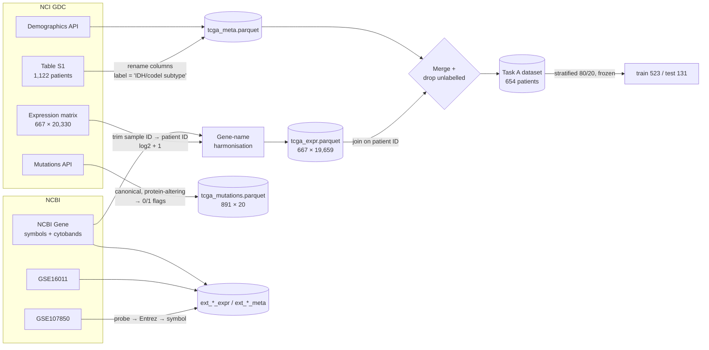
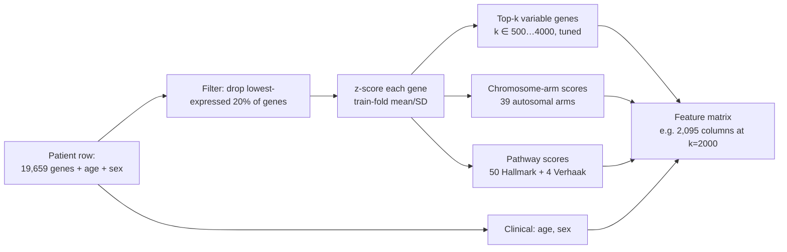
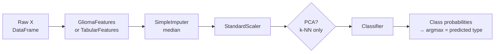
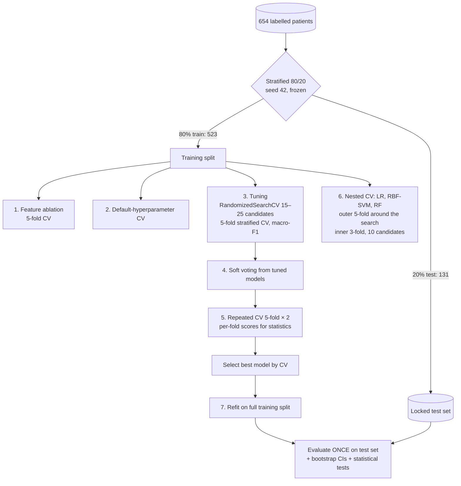
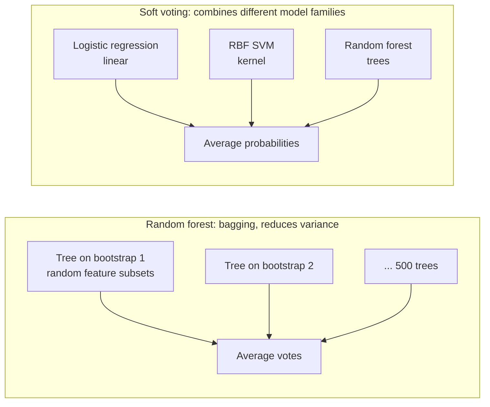
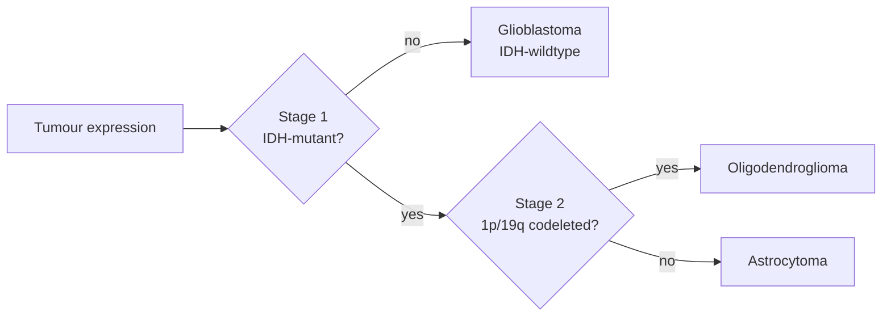

# Brain Cancer (Glioma) Classification with Machine Learning — End-to-End Guide

> How we built the dataset, how we modelled it, and how the model architectures fit together.
> All numbers below come from the project's own output files in `reports/tables/` unless marked *planned*
> or *preliminary*.

---

## Contents

1. [The problem in one page](#1-the-problem-in-one-page)
2. [Project status at a glance](#2-project-status-at-a-glance)
3. [Data sources](#3-data-sources)
4. [How the dataset was built](#4-how-the-dataset-was-built)
5. [Exploratory data analysis: what the data told us](#5-exploratory-data-analysis-what-the-data-told-us)
6. [Feature derivation](#6-feature-derivation)
7. [Modelling architecture](#7-modelling-architecture)
8. [Regularization strategy](#8-regularization-strategy)
9. [Hyperparameter tuning and validation protocol](#9-hyperparameter-tuning-and-validation-protocol)
10. [Ensemble architectures](#10-ensemble-architectures)
11. [Results so far](#11-results-so-far)
12. [Planned architectures and next steps](#12-planned-architectures-and-next-steps)
13. [Repository layout and how to run](#13-repository-layout-and-how-to-run)
14. [Glossary](#14-glossary)
15. [References](#15-references)

---

## 1. The problem in one page

**Plain-language version.** Gliomas are the most common cancer that starts in the brain. Adult diffuse gliomas
come in three main types, and they behave very differently:

| Tumour type | How it behaves | Label used in our code |
|---|---|---|
| **Glioblastoma** | Most aggressive; median survival is about 1–2 years | `IDHwt` |
| **Astrocytoma** | Intermediate | `IDHmut-non-codel` |
| **Oligodendroglioma** | Slowest growing, best outlook | `IDHmut-codel` |

Since the **WHO 2021 classification**, the type is decided by **genetic lab tests**, not by microscope
appearance alone:

- Is the *IDH* gene mutated?
- Are the chromosome pieces *1p* and *19q* both missing ("codeleted")?

These tests cost money and are not available everywhere. A single RNA-sequencing test, which measures how
active every gene is, already carries the "fingerprint" of each type.

**ML task:** supervised **3-class classification**. The input is a tumour's gene-activity profile plus age and
sex. The output is one of the three tumour types.

**Two supporting tasks** reuse the same machinery:

| Task | Classes | Purpose |
|---|---|---|
| **A: main** | 3 WHO-2021 types (above) | The project |
| **B: extension** *(paused, see §12)* | 7 pan-glioma methylation subtypes (Ceccarelli 2016) | A harder, finer-grained, imbalanced version |
| **C: benchmark** | Lower-grade glioma vs glioblastoma | Compare with published work (Tasci et al. 2022) |

This project uses **gene-expression data, not MRI images**.

---

## 2. Project status at a glance

| Stage | Status |
|---|---|
| Data download from official sources (aria2c + APIs), provenance manifest | ✅ done (354 MB) |
| Literature scrape (PubMed), baseline extraction | ✅ done |
| Dataset build (merge, gene harmonisation, labels, external cohorts) | ✅ done |
| EDA | ✅ done |
| Feature derivation + ablation | ✅ done (Tasks A, C) |
| Training, tuning, repeated CV, nested CV | ✅ Task A, ✅ Task C, ⏸ Task B (not trained) |
| Model set reduced to 6 models + soft voting | ✅ done (see §7) |
| Soft voting (LR + RBF-SVM + RF) | ⏳ needs refitting (a few minutes) |
| Held-out test evaluation, statistical tests, SHAP | ✅ Tasks A, C |
| External validation on GEO cohorts | 🟡 preliminary (smoke-test models; to be re-run) |
| Regularization study figures | ⏳ code ready, run pending |
| `glioma-predict` CLI, `glioma-all` runner | ✅ done |
| Model card | ⏳ planned |

---

## 3. Data sources

**Rule followed throughout:** only government or peer-reviewed research repositories are used; no Kaggle and
no GitHub. Every file is logged with URL, download time, size and MD5 checksum in `data/raw/MANIFEST.csv`.

| # | Source | Run by | What we take | Role |
|---|---|---|---|---|
| 1 | GDC publication page for *Ceccarelli et al., Cell 2016* | US National Cancer Institute | RNA-seq gene-expression matrix (667 tumours × 20,330 genes) | **Model input** |
| 2 | Same page: **Table S1** | Paper authors, hosted by NCI | 1,122 patients: IDH status, 1p/19q status, **IDH/codel subtype**, age, sex, grade, survival, … | **Labels** + clinical |
| 3 | Same page: GISTIC copy-number matrix | NCI | Measured DNA copy number per gene | EDA only: validates derived features. **Never a model input** |
| 4 | GDC REST API `/ssm_occurrences` | NCI | Open-access somatic mutations, 20 genes, 788 patients | Task C input |
| 5 | GDC REST API `/cases` | NCI | Race, ethnicity, diagnosis for 1,133 cases | Task C input, EDA |
| 6 | NCBI GEO **GSE107850** + GPL14951 probe table (62 MB, table only) | US National Library of Medicine | 195 grade-II gliomas (EORTC 22033 trial), Illumina microarray, IDH status | **External test only** |
| 7 | NCBI GEO **GSE16011** (probe IDs already contain Entrez IDs, so no platform file is needed) | US National Library of Medicine | 276 gliomas (Gravendeel 2009), Affymetrix microarray, histology | **External test only** |
| 8 | NCBI Gene `Homo_sapiens.gene_info` | US National Library of Medicine | Official gene symbols, old aliases, Entrez IDs, chromosome band | Gene-name harmonisation, chromosome-arm map |
| 9 | MSigDB (Hallmark + C2/CGP) | Broad Institute | 50 Hallmark pathways, 4 Verhaak 2010 GBM subtype signatures | Pathway features |
| 10 | PubMed E-utilities | US National Library of Medicine | 243 related papers; metrics quoted in abstracts | Literature baselines |

### Downloading

`uv run glioma-download` (`src/glioma/download.py`) does the following:
- Builds one aria2c input list and downloads all missing files **concurrently**: 8 files at a time, up to 8
  connections per file, resumable.
- Sends a descriptive user-agent (NCBI blocks aria2's default one), and uses a single polite connection for
  NCBI's dynamic pages.
- Rejects any file that turns out to be an HTML error page instead of data, so a blocked download fails
  loudly instead of silently corrupting the dataset.
- Calls the GDC JSON API for mutations and demographics.
- Appends every file to `MANIFEST.csv`. In total: 11 files, 354 MB.

---

## 4. How the dataset was built

Code: `src/glioma/build_dataset.py` (`uv run glioma-build`). Output: `data/processed/*.parquet`.



### Step by step

1. **Common key: the patient ID.** Every TCGA patient has a barcode such as `TCGA-CS-4938`. The expression
   file uses longer sample IDs (`TCGA-CS-4938-01A-…`), which we trim to the 12-character patient ID. Duplicates
   are removed, keeping the primary tumour.
2. **Gene-name harmonisation.** The 2015 matrix uses some outdated gene symbols (e.g. `A2BP1`, now `RBFOX1`),
   and a few columns are bare Entrez IDs. Each column is mapped to an **Entrez gene ID** by checking, in order:
   1. the current official symbol;
   2. a *unique* alias (ambiguous aliases are dropped);
   3. a numeric Entrez ID.

   The ID is then mapped back to its current symbol. **96.9% of genes mapped**, and duplicates after mapping
   are averaged. Result: **19,659 genes**.
3. **Scaling.** RSEM-normalised counts → `log2(x + 1)`, so a few very highly expressed genes do not dominate.
4. **Labels.** We read Table S1's column **`IDH/codel subtype`** directly. We never relabel or infer. The paper's
   authors derived it from IDH sequencing and SNP-array 1p/19q copy number, exactly the WHO 2021 rule:

   | IDH test | 1p/19q test | Label |
   |---|---|---|
   | wild-type | — | `IDHwt` (glioblastoma) |
   | mutant | both lost | `IDHmut-codel` (oligodendroglioma) |
   | mutant | intact | `IDHmut-non-codel` (astrocytoma) |

   The Task B label is Table S1's `Supervised DNA Methylation Cluster`. The Task C label is the TCGA project
   (`LGG` / `GBM`).
5. **Merge and filter.** Expression is joined with Table S1 on patient ID. Patients without a label (missing
   or failed lab test) are dropped. **Result: 654 patients**, as follows.

   | Class | Patients |
   |---|---|
   | Astrocytoma (`IDHmut-non-codel`) | 256 |
   | Glioblastoma (`IDHwt`) | 229 |
   | Oligodendroglioma (`IDHmut-codel`) | 169 |

6. **Mutation matrix (Task C).** We keep a GDC mutation call only if it is on the gene's canonical transcript and
   is protein-altering (missense, nonsense, frameshift, splice site, in-frame indel). Calls are pivoted to 0/1
   flags. Exome-sequenced patients with no call get 0. Result: **891 patients × 20 genes**, with labels
   LGG 516 and GBM 375.
7. **Leakage rule.** The lab results that *define* the label (IDH mutation calls, 1p/19q copy number) are
   **never** model inputs for Tasks A/B. Columns called `IDH1`/`IDH2` in the expression table are gene
   *activity* (continuous), not mutation calls. This is enforced by `tests/test_pipeline.py`.
8. **Train/test split.** One stratified 80/20 split (seed 42), frozen to `data/processed/split_<task>.json`.
   Everything (EDA, feature choices, tuning, model selection) uses the training 80% only. The test 20% is
   used **once**, at the end.
9. **External cohorts (GEO).**
   - **Probe mapping.** Probe IDs are mapped to Entrez IDs using the platform tables (Illumina `Entrez_Gene_ID`
     column; Affymetrix custom CDF IDs `<entrez>_at`), then to the same symbols. Shared genes with TCGA:
     18,725 (GSE107850) and 16,605 (GSE16011).
   - **Isolation.** These cohorts are **never used for training**.

### Data samples

Table S1, the label source:

```
Case          Histology          Grade  Age  Sex     IDH test  1p/19q     Label
TCGA-28-5204  glioblastoma       G4     72   male    WT        non-codel  IDHwt
TCGA-DB-A64W  oligoastrocytoma   G3     65   female  Mutant    codel      IDHmut-codel
TCGA-DU-A7TJ  astrocytoma        G3     55   male    WT        non-codel  IDHwt   ← looks like astrocytoma,
                                                                                    molecularly glioblastoma-type
TCGA-14-1401  glioblastoma       G4     54   male    (missing) non-codel  (none)  ← dropped: no confirmed label
```

The final model input (log2 expression of 5 of the 19,659 genes, plus clinical fields):

```
Patient       EGFR   CHI3L1  PDPN   OLIG2  IDH1   Age  Sex     Label
TCGA-CS-4941  16.73  15.36   13.38  12.57  12.23  67   male    IDHwt            (glioblastoma)
TCGA-CS-4938  11.86   7.48    9.90  13.16  11.81  31   female  IDHmut-non-codel (astrocytoma)
TCGA-CS-5390  14.97   7.99    6.69  14.50  11.76  47   female  IDHmut-codel     (oligodendroglioma)
```

---

## 5. Exploratory data analysis: what the data told us

Code: `src/glioma/eda.py`. Figures: `reports/figures/eda_*.png`. Label-dependent analyses use the **training
split only**.

| Finding | Evidence | Consequence for modelling |
|---|---|---|
| **p ≫ n**: 19,659 genes vs 523 training patients | — | Regularisation and feature reduction are mandatory |
| Variance is concentrated | Top-2,000 genes hold 44% of total variance; 15.6% of values are 0; 15% of genes have mean log2 < 1 | Drop the lowest-expressed 20% of genes; tune *k* top-variance genes |
| Classes separate clearly | t-SNE shows three clean clusters; PC1 separates IDH-wildtype | High accuracy is plausible, so watch for leakage if F1 = 1.0 |
| 12,706 genes differ between types | Kruskal–Wallis, Bonferroni-corrected | Many redundant signals, which favours sparse (L1) models |
| Age differs strongly | Kruskal–Wallis p = 6e-33; glioblastoma patients are older | Age is included as a feature |
| **Batch effect**: tissue-source site | Sites sent mostly LGG or mostly GBM. Site explains up to 17% of PCs 7–10 vs ≈2% for subtype | Prefer biology-grounded derived features; validate externally |
| Mutations match known biology | IDH1 in 96%/92% of IDH-mutant classes and 0% of IDH-wildtype; TP53+ATRX in astrocytoma (89%/71%); CIC/FUBP1 in oligodendroglioma (63%/27%); EGFR/PTEN in IDH-wildtype (29%/25%) | Confirms label quality |
| Survival differs sharply | Kaplan–Meier by class | Confirms the classes are clinically meaningful |
| Class imbalance | Task A 1.5 : 1, Task C 1.4 : 1, **Task B 19.5 : 1** (LGm6-GBM n = 12) | `class_weight="balanced"`; macro-F1 as primary metric |
| Missing clinical fields | KPS, MGMT, TERT often missing | Only age and sex are used as clinical inputs |

---

## 6. Feature derivation

Code: `src/glioma/features.py`. All features are scikit-learn transformers. They are fit **inside each CV fold**,
so statistics (gene means and SDs, top-*k* gene choice) never see the validation or test fold.



| Feature group | How it is computed | Why |
|---|---|---|
| **Top-k genes** | Rank genes by variance in the training fold; keep the top *k* (tuned) | Most informative genes; label-free, so no leakage |
| **Chromosome-arm scores** | For each autosomal arm, take the mean z-score of its genes, minus the sample's genome-wide mean. Gene → arm comes from NCBI cytobands | A lost arm lowers the activity of *all* its genes, so the 1p and 19q scores are an expression proxy for **1p/19q codeletion** and the 7 and 10 scores for the **+7/−10 glioblastoma signature** |
| **Pathway scores** | Mean z-score of each gene set's genes | Biologically interpretable; robust to single-gene noise and platform differences |
| **Clinical** | Age, sex (1 = male) | Age is strongly type-associated |
| **Task C derived** | `idh_any` (IDH1 ∨ IDH2), `astro_sig` (TP53 ∧ ATRX), `oligo_sig` (CIC ∨ FUBP1), `gbm_sig` (EGFR ∨ PTEN ∨ NF1), panel burden, age > 50 | Encode the known co-mutation programs |

### Validation of the arm features

The arm scores are computed from expression alone, so we checked them against *measured* copy number
(GISTIC, which is never a model input):

| Arm | Pearson r (expression score vs measured copy number) |
|---|---|
| 1p | **0.973** |
| 19q | 0.907 |
| 7q | 0.925 |
| 10q | 0.971 |

### Ablation: does each group earn its place?

5-fold CV macro-F1 on the Task A training split:

| Features | # features | Logistic reg. | Random forest |
|---|---|---|---|
| Top-2000 genes only | 2,000 | 0.979 | 0.970 |
| **Arm scores only** | **39** | **0.957** | 0.953 |
| Pathway scores only | 54 | 0.928 | 0.873 |
| Derived only (arms + pathways + clinical) | 95 | 0.968 | 0.958 |
| **All** | 2,095 | **0.981** | **0.970** |

So **39 interpretable arm scores alone reach 0.96**, and combining everything gives the best result. In the
model explanations (SHAP), `arm:1p` is the single most important feature, followed by `arm:19q` for the
oligodendroglioma class.

---

## 7. Modelling architecture

Code: `src/glioma/models.py`. Every model is wrapped in the **same pipeline**, so the comparison is fair and
leak-free:



Implementation notes:
- **Caching.** The pipeline has a joblib cache, so transformer outputs are reused across hyperparameter
  candidates. The cache is cleared after each training run.
- **Parallelism.** Models run single-threaded, and the parallelism happens at the CV-fold level (5–8
  workers). This avoids thread over-subscription on the 8-core laptop.
- **Class imbalance.** `class_weight="balanced"` is used wherever supported.

### Model zoo

The project deliberately uses a **small set of models**: five single models, one bagging ensemble and one
combining ensemble. Earlier versions also trained naive Bayes, bagged trees, extra trees, XGBoost, LightGBM
and stacking. They were removed because they were statistically tied with simpler models (or clearly
weaker) and made the analysis harder to explain.

| Model | How it works | Why it suits this data | Key hyperparameters (searched) |
|---|---|---|---|
| **Logistic regression (elastic-net)** | A linear score per class, turned into probabilities with softmax; L1 + L2 penalty | Sparse, interpretable gene signatures when p ≫ n; correlated genes grouped by L2 | `C` (1e-3 to 10, log), `l1_ratio` (0–1), *k* |
| **Linear SVM** | Maximum-margin hyperplane | Strong in high dimensions | `C` (1e-5 to 1, log), *k* |
| **RBF SVM** | Kernel trick gives a non-linear boundary | Captures interactions | `C` (0.1–1000), `gamma` (1e-5 to 0.1), *k* |
| **k-NN** (after PCA) | Majority vote of the nearest training patients | Simple non-parametric baseline; PCA because distances degrade in 2,000-D | `n_neighbors`, `weights`, `p`, PCA components, *k* |
| **Decision tree** | Greedy yes/no splits | Interpretable; shows overfitting and pruning clearly | `max_depth`, `min_samples_leaf`, `ccp_alpha`, criterion |
| **Random forest** | 500 trees on bootstrap samples, random feature subset per split, votes averaged | Bagging ensemble: de-correlated trees, lower variance | `max_features`, `min_samples_leaf`, `max_depth`, *k* |
| **Soft voting** | Average of the probabilities from LR, RBF-SVM and RF | Linear, kernel and tree models make different errors | — (members are tuned first) |

SVM probabilities come from Platt scaling (`CalibratedClassifierCV`), because `SVC(probability=True)` is
deprecated in scikit-learn 1.9.

**Metric.** Macro-F1 is the primary metric, because it gives every class equal weight and the classes are
imbalanced. Accuracy alone would hide errors on the smaller classes.

---

## 8. Regularization strategy

Every flexible model overfits this data by default. With default hyperparameters, **train F1 = 1.000** for the
SVMs, k-NN, the decision tree and the random forest on Task A. The regularisers used:

| Model | Regulariser | Effect |
|---|---|---|
| Logistic regression | **Elastic-net** (L1 + L2), strength `1/C` | L1 sets most gene weights to exactly 0 (built-in feature selection): only **145** features keep non-zero weight. L2 shrinks and groups correlated genes on the same deleted arm. Tuned: C = 0.0071, l1_ratio = 0.18 |
| SVMs | `C` (margin softness) | Smaller C gives a wider margin and tolerates some training errors |
| Decision tree | `max_depth`, `min_samples_leaf`, **cost-complexity pruning** `ccp_alpha` | Removes branches that only fit noise. Tuned: depth 9, leaf ≥ 3, ccp_alpha = 0.016 |
| Random forest | Bootstrap averaging, `max_features`, `max_depth`, `min_samples_leaf` | Variance reduction. Tuned: depth 10, 20% of features per split, leaf ≥ 4 |
| k-NN | PCA to 10 components, `n_neighbors` | Fewer, denser dimensions; more neighbours give a smoother boundary |
| All | Variance-filtered top-*k* genes | Implicit dimensionality regularisation |

**Evidence:**
- **Done.** The train-vs-CV gap shrinks after tuning. For example, logistic regression's gap is 0.002 after
  tuning.
- **Planned.** `uv run glioma-regularization` will produce these figures:
  - penalty paths: CV F1 and number of non-zero genes vs C, for L1 / L2 / elastic-net;
  - learning curves: unregularised vs tuned;
  - tree depth and pruning curves;
  - SVM C curve;
  - random-forest depth and leaf-size curves.

---

## 9. Hyperparameter tuning and validation protocol

Code: `src/glioma/train.py` (`uv run glioma-train`).



Why each piece:

| Component | Why |
|---|---|
| **Random search** with log-uniform ranges | Better coverage than a grid for the same budget; scale parameters (C, gamma, ccp_alpha) vary over orders of magnitude |
| ***k* (number of genes) tuned jointly** | The feature step is part of the model |
| **Repeated CV** | Gives per-fold scores for the corrected t-test |
| **Nested CV** (outer 5-fold; inner 3-fold × 10 candidates; LR, RBF-SVM, RF) | Picking the best of many candidates on the same folds is optimistically biased; nested CV measures that bias |
| **Single use of the test set** | Prevents "tuning on the test set" |

**Nested CV result (Task A):** the tuning procedure is not over-optimistic.

| Model | Inner (optimistic) | Outer (honest) |
|---|---|---|
| Logistic reg. | 0.987 | 0.981 ± 0.010 |
| RBF SVM | 0.983 | 0.983 ± 0.007 |
| Random forest | 0.983 | 0.983 ± 0.012 |

What tuning changed is in `reports/tables/<task>_tuning_best.csv`, with impact plots in
`reports/figures/tune_<task>_hyperparameters.png`. The largest tuning gains were for the weak learners:

| Model | Task A gain | Task C gain |
|---|---|---|
| k-NN | +0.016 | +0.039 |
| Decision tree | +0.012 | +0.067 |
| Random forest | +0.013 | +0.020 |

Tuning barely changed the strong linear models (±0.004).

---

## 10. Ensemble architectures



| Ensemble | Family | What it fixes | Task A test macro-F1 |
|---|---|---|---|
| Random forest | Bagging + feature subsampling | The single tree's variance: 0.957 → 0.978 | 0.978 |
| Soft voting | Heterogeneous averaging | Combines linear, kernel and tree views | pending refit |

**Honest conclusion.** On Task A the random forest is **statistically tied** with the regularised linear models.
- **CV:** the corrected t-test against logistic regression gives p = 0.86.
- **Test set:** McNemar shows 1 patient classified differently.

The signal (whole-arm 1p/19q loss, IDH-driven programs) is strong and nearly linear, so extra model capacity
cannot add much. The clear benefit of the ensemble is over the single tree: 0.957 → 0.978.

---

## 11. Results so far

### Task A: 3 glioma types (main)

Best model **chosen by CV**: logistic regression (elastic-net), CV macro-F1 0.984. On the **held-out test set
(131 patients)**:

| Model | Accuracy | Macro-F1 | 95% CI (bootstrap) | ROC-AUC | MCC |
|---|---|---|---|---|---|
| **Logistic reg. (EN)** (selected by CV) | 0.970 | **0.970** | 0.939 – 0.994 | 0.992 | 0.954 |
| Linear SVM | 0.985 | 0.985 | 0.962 – 1.000 | 0.995 | 0.977 |
| RBF SVM | 0.985 | 0.985 | 0.962 – 1.000 | 0.995 | 0.977 |
| Random forest | 0.977 | 0.978 | 0.952 – 1.000 | 0.995 | 0.965 |
| Decision tree | 0.954 | 0.957 | 0.922 – 0.986 | 0.973 | 0.931 |
| k-NN | 0.939 | 0.940 | 0.896 – 0.978 | 0.996 | 0.908 |

The SVMs score slightly higher on test, but the model is chosen by CV, not by test score. That keeps the
test score an honest estimate. The differences between logistic regression, the SVMs and the random forest
are not statistically significant: corrected t-test p = 0.73–0.86, McNemar p ≥ 0.5.

Per class, for the selected logistic regression:

| Class | Precision | Recall | F1 | Test patients |
|---|---|---|---|---|
| Glioblastoma (`IDHwt`) | 0.978 | 0.978 | 0.978 | 46 |
| Astrocytoma (`IDHmut-non-codel`) | 0.980 | 0.941 | 0.960 | 51 |
| Oligodendroglioma (`IDHmut-codel`) | 0.944 | 1.000 | 0.971 | 34 |

**Errors (4 of 131), discussed for false negatives:**
1. A glioblastoma predicted as astrocytoma (confidence 0.59). This is the clinically worst error type, because it
   under-calls an aggressive tumour.
2. A grade-2 oligoastrocytoma (true astrocytoma) predicted as glioblastoma, with low confidence (0.41). Mixed
   histology is a known grey zone.
3. A grade-3 astrocytoma predicted as oligodendroglioma (0.93).
4. A grade-2 tumour labelled astrocytoma but diagnosed histologically as oligodendroglioma, predicted as
   oligodendroglioma (0.50). The model sided with the histology.

**Calibration (ECE, lower is better):**

| Model | ECE |
|---|---|
| RBF SVM | 0.017 |
| Random forest | 0.062 |
| Logistic regression | 0.145 |

Strong regularisation makes logistic regression's probabilities under-confident.

**Interpretation.**
- **SHAP (random forest):** the top feature is `arm:1p`, which drives the oligodendroglioma class. It is
  followed by known glioblastoma genes (RBP1, PDPN, EMP3), then `arm:19q`.
- **Elastic-net logistic regression:** keeps 145 non-zero features. They include known glioblastoma markers
  (PDPN, IGFBP2, TIMP1, EMP3).

### Task C: lower-grade glioma vs glioblastoma (benchmark)

| | Accuracy | Notes |
|---|---|---|
| Tasci et al. 2022 (PMID 36430631) | 0.876 | Quote scraped from abstract: "achieves 87.606% … accuracy rates on TCGA" |
| Tasci et al. 2023, GradWise (PMID 37760597) | 0.870 | "accuracy rate of 87.007% with 13 features … on the TCGA" |
| **This project**: logistic regression (selected by CV), held-out test, 179 patients | **0.894** | Macro-F1 0.893 (CI 0.843–0.937) |

Every model sits at about 0.86–0.87 CV macro-F1. The ceiling comes from the labels themselves: TCGA "LGG"
includes grade-3 IDH-wildtype tumours that are biologically glioblastoma-like under WHO 2021.

### External validation (preliminary)

These results come from models tuned in the *smoke-test* run. They will be re-run on the final models.

The models were retrained on rank-normalised shared genes and applied to microarray data from other
institutions **without refitting**:

| Cohort | Check | Result (logistic regression / random forest) |
|---|---|---|
| GSE107850 (EORTC trial, 180 with IDH status) | IDH-mutant vs wild-type accuracy | **96.7%**, AUC 0.86; sensitivity 0.99, specificity 0.64–0.71 (only 14 wild-type cases) |
| GSE16011 (276 gliomas) | Glioblastomas predicted IDH-wildtype | 84–85% (expected ≈ 90% in adults) |
| GSE16011 | Oligodendrogliomas predicted codeleted | 67–73% (histology-era oligodendrogliomas include non-codeleted cases) |

---

## 12. Planned architectures and next steps

### 12.1 Simplified model zoo *(done)*
- **LightGBM:** removed first, because it gave identical test predictions to XGBoost.
- **Naive Bayes, bagged trees, extra trees, XGBoost and stacking:** removed afterwards, to keep the project
  focused and explainable.

Requirements are still fully covered:
- **Classification:** five single models.
- **Regularisation:** elastic-net, C, pruning, forest depth and leaf size.
- **Tuning:** random search + nested CV.
- **Ensembles:** random forest (bagging) and soft voting.

What this costs: XGBoost had the best CV score (0.990), but its lead over logistic regression was not
significant (p = 0.33), and its test score (0.978) equalled the random forest's.

### 12.2 Two-stage hierarchical classifier *(proposed)*
This follows the WHO 2021 diagnostic flow, and it is the natural two-stage design for this data:



- **Stage 1.** A binary classifier (IDH-mutant vs wild-type) trained on all patients. This is also the label
  available in the external GSE107850 cohort, which makes external validation direct.
- **Stage 2.** A binary classifier trained only on IDH-mutant patients. `arm:1p` and `arm:19q` should dominate.
- **Evaluation.** Stage-wise metrics, plus end-to-end metrics. Errors propagate: a stage-1 miss cannot be
  fixed by stage 2. We then compare against the flat 3-class model.
- **Benefits.** Each stage is simpler and more interpretable, and each maps onto one clinical lab test, which
  is easy to justify in the viva.

### 12.3 Task B (7 methylation subtypes) *(pending decision)*
Task B has its feature ablation done but has not been tuned or evaluated. Early CV macro-F1 values were
logistic regression 0.808 and linear SVM 0.726, which shows how much harder the finer, imbalanced classes are.
Options:
- **Train it**, about 15–20 minutes with the reduced model set.
- **Drop it** and keep the project focused on Task A + Task C.

### 12.4 Delivery: using the trained model
- ✅ **`glioma-predict`.**
  - Input: a CSV/TSV of gene expression, one row per sample, plus optional age and sex.
  - The input is aligned to the model's genes; missing genes are filled with the training mean, and raw
    counts are log-transformed.
  - Output: predicted tumour type + class probabilities + the top 3 features behind each prediction (SHAP for
    the forest, coefficient × value for logistic regression).
  - `--make-example` writes a demo file from held-out patients. On that demo, 5 of 5 are correct.
- ✅ **`glioma-all`.** Runs download → build → EDA → train → evaluate → external → report, with
  `--from/--to/--only` to run a slice. `--list` marks which stages fit models.
- ✅ **Smaller downloads.**
  - The 2.4 GB GEO "family" file was replaced by its 62 MB table-only version, with identical results. Two
    unused files were dropped.
  - Total download: 2.9 GB → 354 MB.
  - NCBI blocks aria2's default user-agent, so the downloader sends a project user-agent and rejects HTML
    error pages.
- ⏳ **Model card.** `models/MODEL_CARD.md` covering intended use (research and teaching, not clinical
  diagnosis), data, metrics and known limitations.

### 12.5 Why not deep learning? *(design decision)*
With 523 training patients and about 20,000 features, a neural network would need heavy regularisation and
would be hard to justify against linear models that already reach about 0.98. Classical models are also
explainable in the viva.

### 12.6 Possible extension: MRI *(out of scope, noted)*
The team's original idea used MRI images. The NCI's Cancer Imaging Archive (TCIA) has glioma MRI with
IDH/1p19q labels (e.g. UCSF-PDGM). The same labels and the same two-stage design would apply, with radiomic
features instead of genes. This would be a separate project.

---

## 13. Repository layout and how to run

```
ml2/
├── pyproject.toml          uv project, dependencies, CLI entry points
├── README.md
├── docs/
│   ├── PROJECT_END_TO_END.md   ← this document
│   └── ML_Project_Synopsis.txt
├── src/glioma/
│   ├── pipeline.py         glioma-all: run every stage in order
│   ├── predict.py          glioma-predict: use a trained model on new samples
│   ├── config.py           paths, seed, CV folds, test size
│   ├── download.py         aria2c + GDC API downloads, MANIFEST.csv
│   ├── literature.py       PubMed scrape, metric + baseline extraction
│   ├── build_dataset.py    raw → processed parquet (§4)
│   ├── data.py             task loading, frozen stratified split
│   ├── features.py         GliomaFeatures, TabularFeatures, SampleRankNormalizer (§6)
│   ├── models.py           model zoo + search spaces (§7)
│   ├── train.py            ablation, CV, tuning, ensembles, nested CV (§9)
│   ├── regularization.py   regularisation study (§8)
│   ├── tuning_analysis.py  hyperparameter-impact plots
│   ├── evaluate.py         test metrics, CIs, statistical tests, SHAP, errors (§11)
│   ├── external.py         GEO external validation
│   ├── plots.py            shared, colour-blind-safe plot style
│   └── report.py           builds reports/report.md from tables
├── tests/test_pipeline.py  leakage + sanity tests (11 tests)
├── data/                   raw/ interim/ processed/   (git-ignored, re-creatable)
├── models/<task>/          trained pipelines (*.joblib), best_params.json
└── reports/                figures/*.png, tables/*.csv, report.md
```

```bash
uv sync
uv run glioma-all              # or stage by stage:
uv run glioma-download        # ~354 MB
uv run glioma-literature
uv run glioma-build
uv run glioma-eda
uv run glioma-train           # Task A ≈ 15–20 min, Task C ≈ 2 min on 8 cores; --fast for a smoke test
uv run glioma-regularization
uv run glioma-tuning-plots
uv run glioma-evaluate
uv run glioma-external
uv run glioma-report
uv run glioma-predict --make-example demo.tsv && uv run glioma-predict --input demo.tsv
uv run pytest
```

Hardware used: 8-core laptop CPU, 7 GB RAM (peak usage about 1.1 GB during the dataset build). No GPU is
needed.

---

## 14. Glossary

| Term | Meaning |
|---|---|
| **Glioma** | Brain cancer arising from glial (support) cells |
| **IDH mutation** | A change in the *IDH1/IDH2* gene; IDH-mutant gliomas grow more slowly |
| **1p/19q codeletion** | Loss of the short arm of chromosome 1 and the long arm of chromosome 19; defines oligodendroglioma |
| **RNA-seq / gene expression** | Measures how active each gene is in the tumour |
| **TCGA** | The Cancer Genome Atlas, a US NIH program that profiled thousands of tumours |
| **GDC** | NCI's Genomic Data Commons, the official TCGA data portal |
| **GEO** | NCBI's Gene Expression Omnibus, a public archive of expression studies |
| **Macro-F1** | Average of per-class F1 scores; treats small and large classes equally |
| **Cross-validation (CV)** | Train on 4/5 of the training data and validate on 1/5, rotating 5 times |
| **Nested CV** | CV around the tuning procedure itself, for an honest estimate |
| **Elastic-net** | Penalty mixing L1 (sparsity) and L2 (shrinkage) |
| **SHAP** | Method that attributes each prediction to the features that drove it |
| **Data leakage** | When information from validation or test data, or from the label itself, sneaks into training |

---

## 15. References

1. Ceccarelli M, et al. Molecular profiling reveals biologically discrete subsets and pathways of progression in
   diffuse glioma. *Cell* 164(3):550–563, 2016. Data: https://gdc.cancer.gov/about-data/publications/lgggbm_2016
2. Louis DN, et al. The 2021 WHO Classification of Tumors of the Central Nervous System: a summary.
   *Neuro-Oncology* 23(8):1231–1251, 2021.
3. Tasci E, et al. Hierarchical voting-based feature selection and ensemble learning model scheme for glioma
   grading with clinical and molecular characteristics. *Int J Mol Sci*, 2022. PMID 36430631.
4. Tasci E, et al. GradWise: a novel application of a rank-based weighted hybrid filter and embedded feature
   selection method for glioma grading. *Cancers*, 2023. PMID 37760597.
5. Verhaak RGW, et al. Integrated genomic analysis identifies clinically relevant subtypes of glioblastoma.
   *Cancer Cell*, 2010.
6. Gravendeel LAM, et al. Intrinsic gene expression profiles of gliomas are a better predictor of survival than
   histology. *Cancer Research*, 2009. GEO: GSE16011.
7. EORTC 22033-26033 low-grade glioma trial expression data. GEO: GSE107850.
8. Nadeau C, Bengio Y. Inference for the generalization error. *Machine Learning*, 2003 (corrected resampled
   t-test).
9. Liberzon A, et al. The Molecular Signatures Database Hallmark gene set collection. *Cell Systems*, 2015.
