# Brain cancer (glioma) classification with machine learning

**Data:** NCI GDC / TCGA (Ceccarelli et al., Cell 2016) plus NCBI GEO external cohorts · **Code:** `src/glioma/` · all
numbers in this report are generated by `glioma-report` from `reports/tables/`.

**Summary.** We classify adult diffuse gliomas into the three WHO-2021 molecular types (IDH-wildtype, IDH-mutant
1p/19q-codeleted, IDH-mutant non-codeleted) from tumour gene expression. The best model by CV,
Logistic reg. (EN), reaches macro-F1 0.970 on held-out
patients. A second task benchmarks the pipeline against published work (LGG vs GBM, Tasci et al. 2022). The report covers all seven required components: EDA (§2), feature derivation (§3),
classification (§4), regularisation (§5), hyperparameter tuning (§6), ensembles and performance analysis
(§7–9).


## 1. Data sources and provenance

All data come from **government or peer-reviewed research sources**. Nothing is from Kaggle or another re-upload site.

* **NCI Genomic Data Commons (GDC, US National Cancer Institute)**: the publication page of
  *Ceccarelli et al., "Molecular profiling reveals biologically discrete subsets and pathways of progression
  in diffuse glioma", Cell 164:550-563 (2016)*. It provides the RNA-seq expression matrix (667 tumours ×
  20,330 genes), the paper's **Table S1** (labels and clinical data for 1,122 patients) and GISTIC copy number.
* **GDC REST API**: open-access somatic mutation calls and demographics for TCGA-LGG / TCGA-GBM.
* **NCBI GEO (US National Library of Medicine)**: two independent external cohorts.
  * GSE107850: EORTC 22033-26033 clinical trial, 195 grade-II gliomas with IDH status.
  * GSE16011: Gravendeel et al. 2009, 276 gliomas with histology.
  * The GSE107850 platform's probe table (GSE16011's probe IDs already contain the Entrez gene ID).
* **NCBI Gene**: gene symbols, synonyms and cytobands, used for symbol harmonisation and chromosome-arm mapping.
* **MSigDB (Broad Institute)**: the 50 Hallmark pathways and the Verhaak 2010 glioblastoma subtype signatures.
* **PubMed (NCBI E-utilities)**: 243 related papers scraped. Every accuracy/AUC figure
  quoted in their abstracts is extracted to `tables/literature_metrics.csv` and used as a baseline.

Every file is downloaded by `glioma-download` (aria2c, concurrent) and recorded with URL, timestamp, size and
MD5 in `data/raw/MANIFEST.csv`:

| file                                           | source                  |      MB | description                                                                                |
|:-----------------------------------------------|:------------------------|--------:|:-------------------------------------------------------------------------------------------|
| gdc_pub/LGG-GBM.gene_expression.normalized.txt | api.gdc.cancer.gov      |  52.400 | TCGA LGG+GBM RNASeqV2 RSEM-normalised expression matrix (Ceccarelli 2016 freeze)           |
| gdc_pub/TableS1.PatientData.20151020.v3.xlsx   | api.gdc.cancer.gov      |   0.400 | Ceccarelli 2016 Table S1: per-patient clinical + molecular labels (IDH, 1p/19q, subtypes)  |
| gdc_pub/GISTIC_copy_number_matrix.txt          | api.gdc.cancer.gov      | 174.200 | Ceccarelli 2016 GISTIC copy-number matrix (EDA only, never a Task-A feature)               |
| geo/GSE107850_series_matrix.txt.gz             | ftp.ncbi.nlm.nih.gov    |  30.400 | GEO GSE107850: EORTC 22033-26033 LGG trial expression (Illumina WG-DASL), IDH status       |
| geo/GSE16011_series_matrix.txt.gz              | ftp.ncbi.nlm.nih.gov    |  27.000 | GEO GSE16011: Gravendeel 2009, 284 gliomas (Affymetrix U133 Plus 2, Entrez CDF), histology |
| ncbi/Homo_sapiens.gene_info.gz                 | ftp.ncbi.nlm.nih.gov    |   5.200 | NCBI Gene: human gene symbols, synonyms, Entrez IDs, cytobands                             |
| msigdb/h.all.v2023.2.Hs.symbols.gmt            | data.broadinstitute.org |   0.000 | MSigDB Hallmark gene sets                                                                  |
| msigdb/c2.cgp.v2023.2.Hs.symbols.gmt           | data.broadinstitute.org |   2.800 | MSigDB C2 CGP gene sets (Verhaak 2010 GBM subtypes)                                        |
| gdc_api/tcga_glioma_mutations.parquet          | api.gdc.cancer.gov      |   0.100 | GDC open-access somatic mutations (canonical, protein-altering) for Tasci genes            |
| gdc_api/tcga_glioma_demographics.parquet       | api.gdc.cancer.gov      |   0.000 | GDC case demographics for TCGA-LGG/GBM                                                     |
| geo/GPL14951_table.txt                         | www.ncbi.nlm.nih.gov    |  61.700 | GEO platform GPL14951 probe table (Illumina HumanHT-12 WG-DASL V4)                         |

### Prediction tasks

| task | definition | class counts | max/min imbalance |
|---|---|---|---|
| subtype_3 | 3-class WHO-2021 molecular subtype (IDH / 1p19q) | IDHwt: 229, IDHmut-non-codel: 256, IDHmut-codel: 169 | 1.51 |
| subtype_7 | 7-class pan-glioma DNA-methylation subtype (Ceccarelli 2016) | Classic-like: 69, Mesenchymal-like: 98, LGm6-GBM: 12, PA-like: 25, G-CIMP-low: 17, G-CIMP-high: 234, Codel: 173 | 19.5 |
| grade_2 | LGG vs GBM (Tasci 2022 clinical + mutation setup) | LGG: 516, GBM: 375 | 1.38 |

* **Task A (main)** is the WHO-2021 (CNS5) molecular classification of adult diffuse glioma. **IDH-wildtype**
  corresponds to glioblastoma, **IDH-mutant + 1p/19q-codeleted** to oligodendroglioma, and **IDH-mutant
  non-codeleted** to astrocytoma. The model only sees gene expression, age and sex. The label-defining
  measurements (IDH mutation calls, 1p/19q copy number) are never features.
* **Task B (extended)** is the 7 pan-glioma DNA-methylation subtypes defined in Ceccarelli 2016, predicted from
  expression. Its classes are finer-grained and strongly imbalanced (19.5:1).
* **Task C (baseline replication)** is LGG vs GBM from age, sex, race and 20 mutation flags. It rebuilds the
  setup of Tasci et al. 2022 (the source of UCI dataset #759) from raw GDC data.

The data are split into a stratified 80/20 train/test split (seed 42), frozen to `data/processed/split_<task>.json`.
All EDA, feature selection, tuning and model selection use the **training split only**.


## 2. Exploratory data analysis

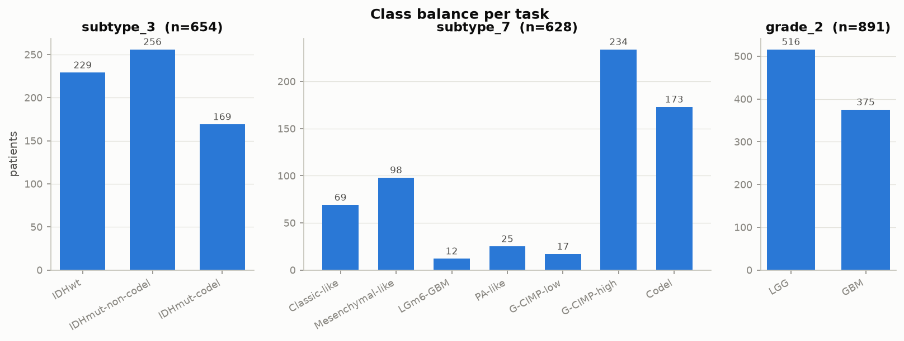

*Class balance for the three tasks*


**Clinical.** Age differs strongly between subtypes (Kruskal–Wallis p = 6.2e-33).
IDH-wildtype patients are older, as expected for glioblastoma. Several clinical fields have substantial missing
values (KPS, MGMT, TERT), which is why the expression models use only age and sex.

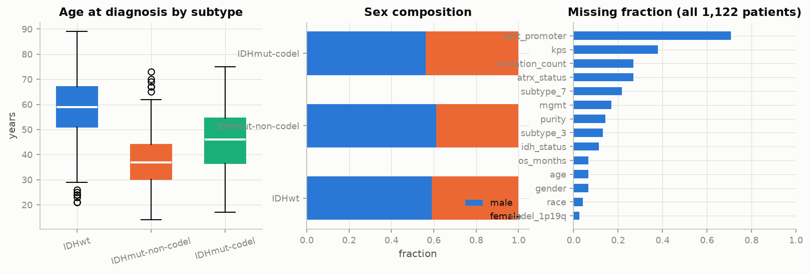

*Age, sex composition and missingness of clinical annotations*


**Expression.** 19,659 genes × 667 tumours. 16%
of values are zero and 15% of genes have mean log2 expression below 1. The
lowest-expressed 20% of genes are therefore filtered inside the feature pipeline. The variance is concentrated:
the top-2,000 genes hold 44% of total variance. With p ≫ n
(~19.7k features vs 523 training samples), regularisation and feature reduction are essential.

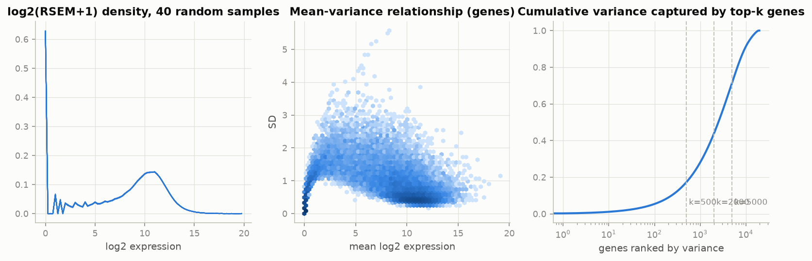

*Expression distributions, mean-variance trend and variance captured by top-k genes*


**Structure.** The three subtypes separate almost perfectly in t-SNE, and IDH-wildtype separates from the rest
along PC1. 12,706 genes differ between subtypes after Bonferroni correction.

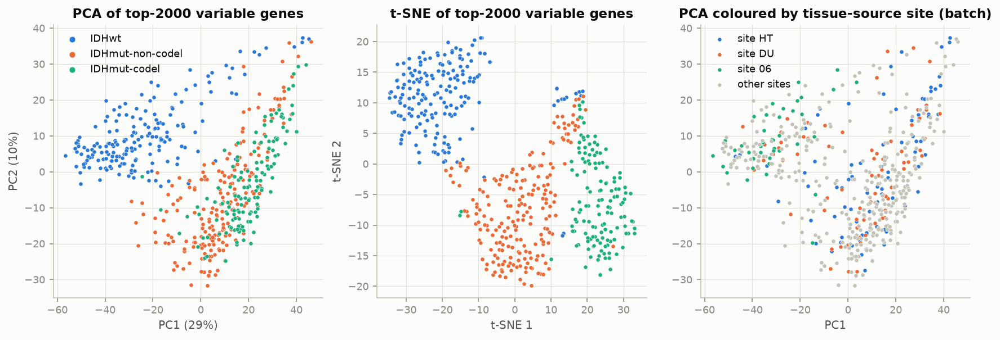

*PCA / t-SNE of the top-2000 variable genes, and PCA coloured by tissue-source site*


**Batch effects.** The tissue-source site explains part of PC1, but sites contributed mainly LGG or mainly GBM,
so site is *confounded* with biology. The later PCs, however, are dominated by site (R² up to 0.17 in PCs 7–10
vs ≈0.02 for subtype). The models are therefore regularised and use derived, biologically grounded features.

|     PC |   var_explained |   subtype |   tissue_site |   study_LGG_vs_GBM |
|-------:|----------------:|----------:|--------------:|-------------------:|
|  1.000 |           0.293 |     0.569 |         0.495 |              0.457 |
|  2.000 |           0.104 |     0.288 |         0.168 |              0.075 |
|  3.000 |           0.055 |     0.124 |         0.098 |              0.041 |
|  4.000 |           0.031 |     0.113 |         0.106 |              0.000 |
|  5.000 |           0.029 |     0.192 |         0.075 |              0.002 |
|  6.000 |           0.026 |     0.350 |         0.106 |              0.004 |
|  7.000 |           0.018 |     0.023 |         0.169 |              0.031 |
|  8.000 |           0.016 |     0.017 |         0.069 |              0.024 |
|  9.000 |           0.013 |     0.002 |         0.085 |              0.001 |
| 10.000 |           0.011 |     0.006 |         0.127 |              0.042 |

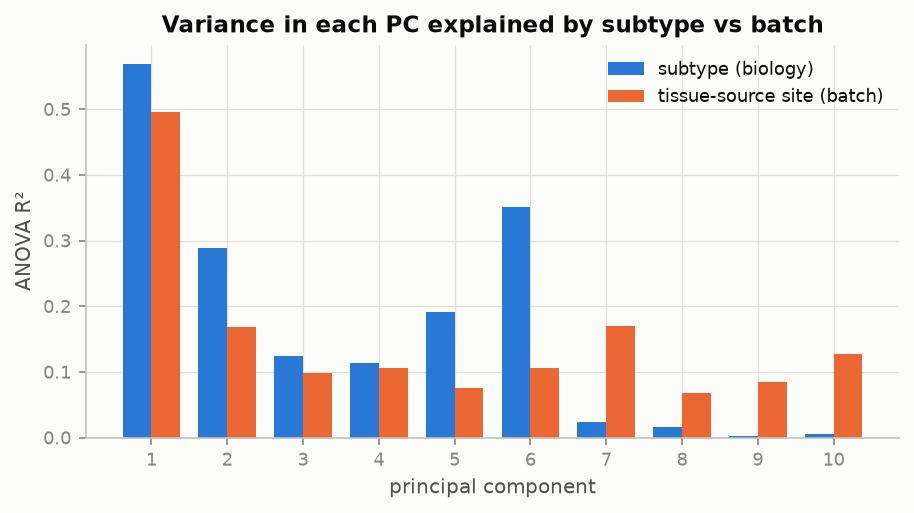

*Share of each PC's variance explained by subtype vs tissue-source site*


**Mutations** reproduce the known biology, which is a check on label quality: IDH1 in >90% of IDH-mutant
tumours, TP53 + ATRX in astrocytomas, CIC + FUBP1 in oligodendrogliomas, and EGFR / PTEN / NF1 in
IDH-wildtype. The co-occurrence matrix shows the mutual exclusivity of these programs.

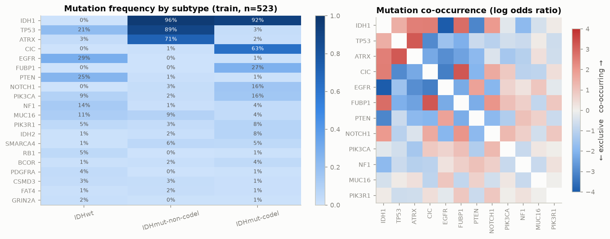

*Mutation frequency by subtype, and pairwise co-occurrence (log odds ratio)*


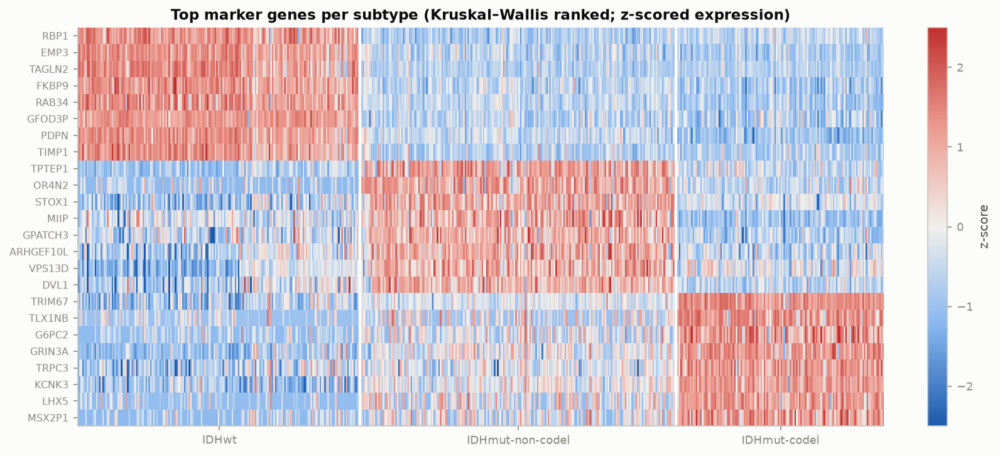

*Top marker genes per subtype (training set)*


**Survival** differs sharply between the three classes, which confirms the classes are clinically meaningful.

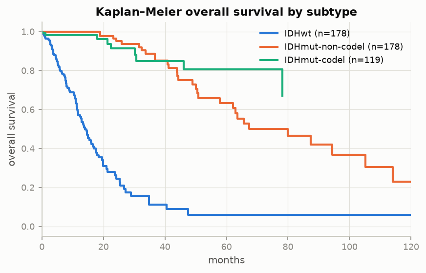

*Kaplan–Meier overall survival by subtype*


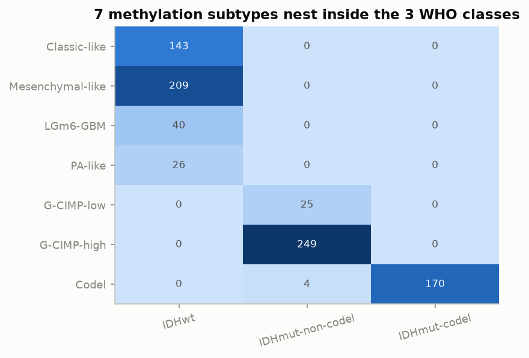

*Task B's 7 methylation subtypes nest inside Task A's 3 classes*


**Data issues found:**
1. p ≫ n.
2. Class imbalance, mild in Tasks A and C and severe in Task B (LGm6-GBM n=12).
3. Batch (site) confounded with grade.
4. Missing clinical fields.
5. Gene symbols from 2015 that needed mapping to current NCBI symbols (96.9% mapped).
6. RNA-seq vs microarray platform differences for external validation.


## 3. Feature derivation

All features are computed by scikit-learn transformers (`glioma/features.py`). These are fit **inside each CV
fold**, so gene filtering, z-scoring and selection never see the validation fold.

| group | features | rationale |
|---|---|---|
| top-k variable genes | k ∈ {500…4000}, tuned | most informative genes; variance filter is label-free, so it does not leak |
| **chromosome-arm scores** | 39 autosomal arms: mean gene z-score on the arm minus the sample's genome-wide mean | a deleted arm lowers expression of all its genes, so 1p/19q scores proxy **1p/19q codeletion** and 7/10 scores proxy the **+7/−10 GBM signature** |
| pathway scores | 50 MSigDB Hallmarks + 4 Verhaak GBM subtypes (mean z) | biologically interpretable, robust to single-gene noise and platform effects |
| clinical | age, sex | age is strongly subtype-associated |
| Task C derived | `idh_any`, `astro_sig` (TP53∧ATRX), `oligo_sig` (CIC∨FUBP1), `gbm_sig` (EGFR∨PTEN∨NF1), panel burden, age>50 | encode known co-mutation programs |

**Validation of the arm features.** The arm scores are computed from expression alone, yet they correlate
with the *measured* GISTIC copy number of the same arm:

| arm   |   pearson_r_expr_score_vs_copy_number |   n |
|:------|--------------------------------------:|----:|
| 1p    |                                 0.973 | 521 |
| 19q   |                                 0.907 | 521 |
| 7q    |                                 0.925 | 521 |
| 10q   |                                 0.971 | 521 |
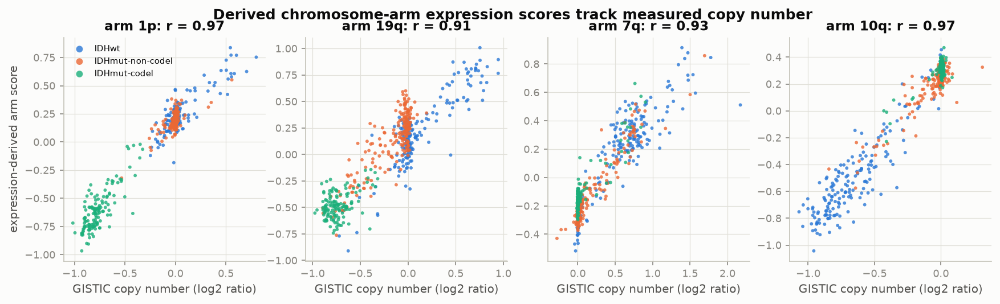

*Expression-derived arm scores vs measured copy number*

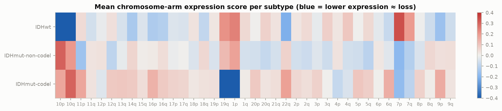

*Mean arm score per subtype: 1p/19q loss in codel, +7/−10 in IDHwt*

**Ablation (5-fold CV on the training split).** This tests whether each feature group earns its place:

**subtype_3** (macro-F1):

| features                              |   n_features |   logreg |   random_forest |
|:--------------------------------------|-------------:|---------:|----------------:|
| all (genes+arms+pathways+clinical)    |     2095.000 |    0.981 |           0.970 |
| arm scores only                       |       39.000 |    0.957 |           0.953 |
| derived only (arms+pathways+clinical) |       95.000 |    0.968 |           0.958 |
| genes only (top-2000)                 |     2000.000 |    0.979 |           0.970 |
| pathway scores only                   |       54.000 |    0.928 |           0.873 |

**subtype_7** (macro-F1):

| features                              |   n_features |   logreg |   random_forest |
|:--------------------------------------|-------------:|---------:|----------------:|
| all (genes+arms+pathways+clinical)    |     2095.000 |    0.788 |           0.560 |
| arm scores only                       |       39.000 |    0.587 |           0.458 |
| derived only (arms+pathways+clinical) |       95.000 |    0.672 |           0.442 |
| genes only (top-2000)                 |     2000.000 |    0.786 |           0.568 |
| pathway scores only                   |       54.000 |    0.627 |           0.469 |

**grade_2** (macro-F1):

| features                           |   n_features |   logreg |   random_forest |
|:-----------------------------------|-------------:|---------:|----------------:|
| raw (clinical + 20 mutation flags) |       25.000 |    0.865 |           0.844 |
| raw + derived combinations         |       31.000 |    0.867 |           0.841 |


## 4. Classification models

Every model is a full pipeline: `features → median-impute → standardise → [PCA for k-NN] → classifier`.
Class weights are `balanced` where supported, to handle imbalance. The primary metric is **macro-F1**,
which weights every class equally. This matters for Task B's rare classes.

| model              | family    | how it works / why here                                                                                                                                                           |
|:-------------------|:----------|:----------------------------------------------------------------------------------------------------------------------------------------------------------------------------------|
| Logistic reg. (EN) | classical | Multinomial logistic regression: linear log-odds per class, softmax output. Elastic-net (L1+L2) penalty -> sparse, stable gene signatures when p >> n.                            |
| Linear SVM         | classical | Maximum-margin linear separator; C trades margin width against training errors.                                                                                                   |
| RBF SVM            | classical | Kernel SVM: RBF kernel gives a non-linear boundary; gamma sets kernel width.                                                                                                      |
| k-NN               | classical | Instance-based: majority vote of nearest training samples (after PCA, because distances degrade in 2,000-D space).                                                                |
| Decision tree      | classical | Greedy axis-aligned splits that maximise impurity reduction; interpretable but high variance — depth / leaf size / cost-complexity pruning regularise it.                         |
| Random forest      | ensemble  | Bagging + random feature subsets per split -> de-correlated trees, lower variance.                                                                                                |
| Soft voting        | ensemble  | Averages the predicted probabilities of the tuned logistic regression, RBF-SVM and random forest: a linear, a kernel and a tree model make different errors, which partly cancel. |


## 5. Regularisation

With ~2,000 gene features and ~520 samples, every unregularised model can memorise the training set. The
default-hyperparameter runs show train F1 = 1.000 for the SVMs, k-NN, trees and random forest in Task A. The
following regularisers were studied on Task A:

* **L1 / L2 / elastic-net penalties (logistic regression).** As C decreases, the L1 component drives gene
  weights to exactly zero (embedded feature selection), while L2 shrinks all weights. Elastic-net combines
  sparsity with the grouping of correlated genes. It was chosen because co-expressed genes on deleted arms
  are highly correlated.
* **Margin softness C (SVM).**
* **Depth, minimum leaf size and cost-complexity pruning (decision tree).**
* **Tree depth and minimum leaf size (random forest),** on top of the variance reduction from bagging.
* **Implicit regularisation.** Bootstrap averaging (random forest), PCA before k-NN, and the variance-based
  gene filter.


## 6. Hyperparameter tuning

* **Search.**
  * Random search (`RandomizedSearchCV`, 15–25 candidates, 5-fold stratified CV, macro-F1) for every model.
    Distributions are log-uniform for scale parameters (C, gamma, ccp_alpha), which vary over orders of
    magnitude; random search covers them better than a grid of the same size.
  * The feature step's **k_genes** is tuned jointly with each model.
* **Unbiased estimate.** The CV score of the selected configuration is optimistically biased, because it was
  chosen on those same folds. **Nested CV** measures that bias for Tasks A and C: an outer 5-fold loop wraps
  the whole search (inner 3-fold CV, 10 random-search candidates) for logistic regression, RBF SVM and random
  forest.

### subtype_3

| model              | method        |   candidates |   best_cv_f1_macro |   seconds | best_params                                                                                                                                        |
|:-------------------|:--------------|-------------:|-------------------:|----------:|:---------------------------------------------------------------------------------------------------------------------------------------------------|
| Logistic reg. (EN) | random search |           25 |              0.984 |       174 | {"feat__k_genes": 1000, "model__C": 0.0070689749506246055, "model__l1_ratio": 0.18182496720710062}                                                 |
| Linear SVM         | random search |           25 |              0.985 |        34 | {"feat__k_genes": 2000, "model__estimator__C": 0.09609812947036396}                                                                                |
| RBF SVM            | random search |           25 |              0.985 |        69 | {"feat__k_genes": 2000, "model__estimator__C": 153.52246941973468, "model__estimator__gamma": 5.4167545832474595e-05}                              |
| k-NN               | random search |           25 |              0.966 |        17 | {"feat__k_genes": 4000, "model__n_neighbors": 6, "model__p": 2, "model__weights": "distance", "reduce__n_components": 10}                          |
| Decision tree      | random search |           25 |              0.957 |        17 | {"feat__k_genes": 2000, "model__ccp_alpha": 0.015882027186184103, "model__criterion": "gini", "model__max_depth": 9, "model__min_samples_leaf": 3} |
| Random forest      | random search |           15 |              0.980 |        85 | {"feat__k_genes": 2000, "model__max_depth": 10, "model__max_features": 0.2, "model__min_samples_leaf": 4}                                          |

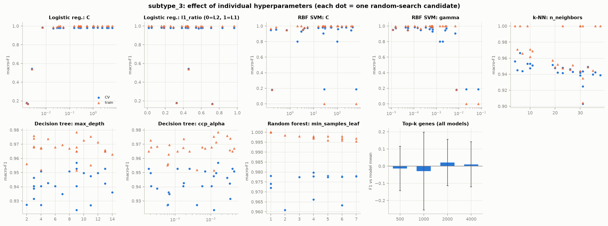

*subtype_3: hyperparameter impact*

**Nested CV (subtype_3)**

| model         |   inner_cv_f1 |   nested_outer_f1 |   nested_outer_sd |   optimism |
|:--------------|--------------:|------------------:|------------------:|-----------:|
| logreg        |         0.987 |             0.981 |             0.010 |      0.007 |
| random_forest |         0.983 |             0.983 |             0.012 |     -0.000 |
| svm_rbf       |         0.983 |             0.983 |             0.007 |     -0.000 |

### grade_2

| model              | method        |   candidates |   best_cv_f1_macro |   seconds | best_params                                                                                                                |
|:-------------------|:--------------|-------------:|-------------------:|----------:|:---------------------------------------------------------------------------------------------------------------------------|
| Logistic reg. (EN) | random search |           25 |              0.867 |         2 | {"model__C": 0.05342937261279776, "model__l1_ratio": 0.2912291401980419}                                                   |
| Linear SVM         | random search |           25 |              0.864 |         2 | {"model__estimator__C": 0.0006789053271698484}                                                                             |
| RBF SVM            | random search |           25 |              0.865 |         3 | {"model__estimator__C": 0.3077180271250685, "model__estimator__gamma": 0.0009565499215943821}                              |
| k-NN               | random search |           25 |              0.863 |         1 | {"model__n_neighbors": 9, "model__p": 1, "model__weights": "uniform"}                                                      |
| Decision tree      | random search |           25 |              0.859 |         1 | {"model__ccp_alpha": 0.02093887591710553, "model__criterion": "gini", "model__max_depth": 6, "model__min_samples_leaf": 9} |
| Random forest      | random search |           15 |              0.865 |        15 | {"model__max_depth": null, "model__max_features": "sqrt", "model__min_samples_leaf": 4}                                    |

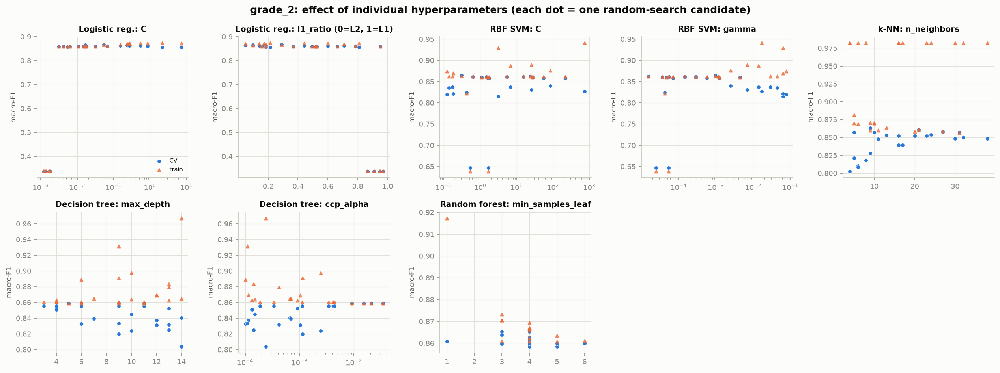

*grade_2: hyperparameter impact*

**Nested CV (grade_2)**

| model         |   inner_cv_f1 |   nested_outer_f1 |   nested_outer_sd |   optimism |
|:--------------|--------------:|------------------:|------------------:|-----------:|
| logreg        |         0.863 |             0.858 |             0.050 |      0.005 |
| random_forest |         0.862 |             0.854 |             0.048 |      0.008 |
| svm_rbf       |         0.862 |             0.858 |             0.046 |      0.003 |


## 7. Ensembles and performance analysis

**Protocol.**
1. The best model per task is chosen by **repeated CV on the training split** (5-fold × 2), never by test score.
2. All tuned models are refit on the full training split and evaluated **once** on the held-out 20% test split.
3. Test uncertainty is reported as 95% bootstrap CIs (1,000 resamples).
4. Models are compared statistically in two ways:
   * the Nadeau–Bengio **corrected resampled t-test** on CV folds, which corrects for the overlap between
     training sets;
   * an exact **McNemar test** on the paired test predictions.


### subtype_3 — 3-class WHO-2021 molecular subtype (IDH / 1p19q)


Best by CV: **Logistic reg. (EN)**, with CV macro-F1 0.984 and **test macro-F1 0.970** (95% CI 0.939–0.994). It made 4 errors out of 131 test patients.


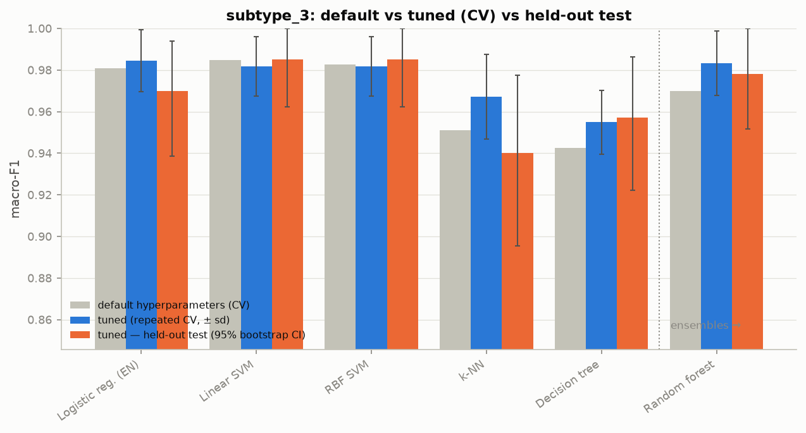

*subtype_3: default vs tuned vs test*


| model              |   default_cv_f1 |   cv_f1 |   cv_f1_sd |   train_f1 |   overfit_gap |   tuning_gain |   test_f1 |   f1_macro_ci_lo |   f1_macro_ci_hi |
|:-------------------|----------------:|--------:|-----------:|-----------:|--------------:|--------------:|----------:|-----------------:|-----------------:|
| Logistic reg. (EN) |           0.981 |   0.984 |      0.015 |      0.986 |         0.002 |         0.004 |     0.970 |            0.939 |            0.994 |
| Linear SVM         |           0.985 |   0.982 |      0.014 |      1.000 |         0.018 |        -0.003 |     0.985 |            0.962 |            1.000 |
| RBF SVM            |           0.983 |   0.982 |      0.014 |      1.000 |         0.018 |        -0.001 |     0.985 |            0.962 |            1.000 |
| k-NN               |           0.951 |   0.967 |      0.020 |      1.000 |         0.033 |         0.016 |     0.940 |            0.896 |            0.978 |
| Decision tree      |           0.943 |   0.955 |      0.015 |      0.979 |         0.024 |         0.012 |     0.957 |            0.922 |            0.986 |
| Random forest      |           0.970 |   0.983 |      0.015 |      0.997 |         0.014 |         0.013 |     0.978 |            0.952 |            1.000 |


**All test metrics**

| model              |   accuracy |   balanced_accuracy |   f1_macro |   f1_weighted |   mcc |   kappa |   log_loss |   roc_auc |   pr_auc |
|:-------------------|-----------:|--------------------:|-----------:|--------------:|------:|--------:|-----------:|----------:|---------:|
| Logistic reg. (EN) |      0.970 |               0.973 |      0.970 |         0.969 | 0.954 |   0.954 |      0.237 |     0.992 |    0.975 |
| Linear SVM         |      0.985 |               0.986 |      0.985 |         0.985 | 0.977 |   0.977 |      0.075 |     0.995 |    0.987 |
| RBF SVM            |      0.985 |               0.986 |      0.985 |         0.985 | 0.977 |   0.977 |      0.072 |     0.995 |    0.987 |
| k-NN               |      0.939 |               0.938 |      0.940 |         0.939 | 0.908 |   0.907 |      0.124 |     0.996 |    0.993 |
| Decision tree      |      0.954 |               0.959 |      0.957 |         0.954 | 0.931 |   0.930 |      0.216 |     0.973 |    0.936 |
| Random forest      |      0.977 |               0.980 |      0.978 |         0.977 | 0.965 |   0.965 |      0.138 |     0.995 |    0.990 |

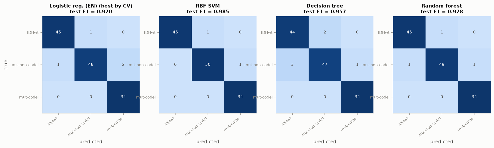

*subtype_3: confusion matrices (test)*


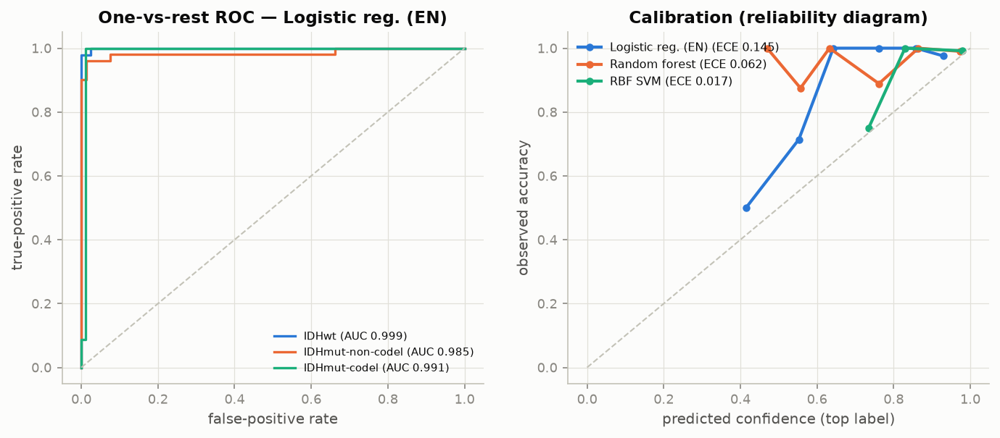

*subtype_3: ROC curves and calibration*


**Per-class (best model)**

|                  |   precision |   recall |   f1-score |   support |
|:-----------------|------------:|---------:|-----------:|----------:|
| IDHwt            |       0.978 |    0.978 |      0.978 |    46.000 |
| IDHmut-non-codel |       0.980 |    0.941 |      0.960 |    51.000 |
| IDHmut-codel     |       0.944 |    1.000 |      0.971 |    34.000 |
| accuracy         |       0.970 |    0.970 |      0.970 |     0.970 |
| macro avg        |       0.967 |    0.973 |      0.970 |   131.000 |
| weighted avg     |       0.970 |    0.970 |      0.969 |   131.000 |


**Statistical comparison against the best model**

| vs_model      |   cv_f1_diff |   corrected_t |   corrected_t_p |   mcnemar_b |   mcnemar_c |   mcnemar_p |
|:--------------|-------------:|--------------:|----------------:|------------:|------------:|------------:|
| Linear SVM    |        0.003 |         0.355 |           0.731 |           0 |           2 |       0.500 |
| RBF SVM       |        0.003 |         0.355 |           0.731 |           0 |           2 |       0.500 |
| k-NN          |        0.017 |         1.686 |           0.126 |           5 |           1 |       0.219 |
| Decision tree |        0.030 |         1.901 |           0.090 |           3 |           1 |       0.625 |
| Random forest |        0.001 |         0.180 |           0.861 |           0 |           1 |       1.000 |

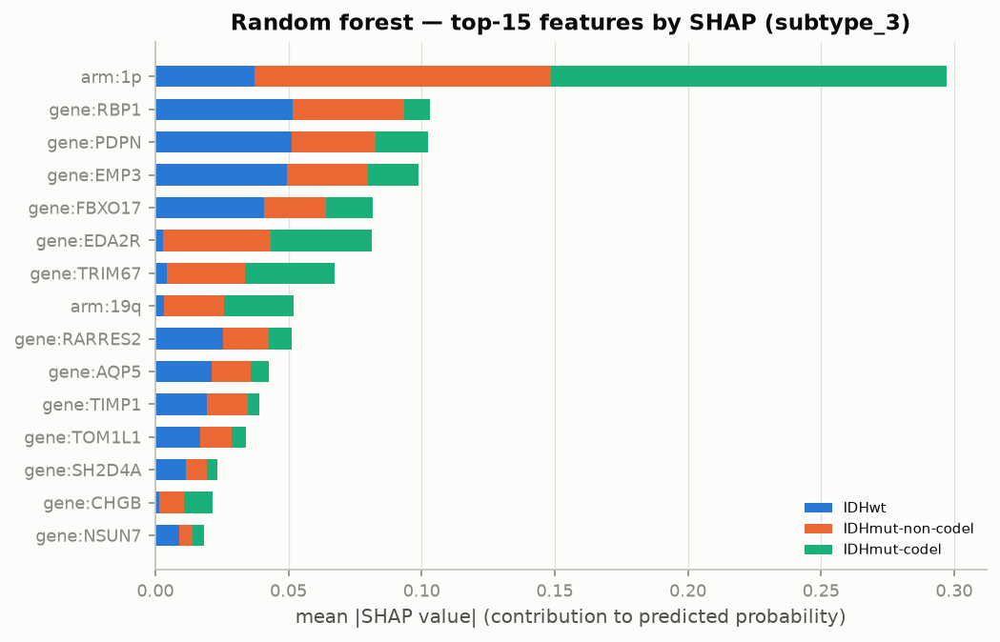

*subtype_3: SHAP feature importance (random forest)*


**Elastic-net logistic regression**: 145 non-zero features; largest coefficients per class:

| class            | feature      |   coef |
|:-----------------|:-------------|-------:|
| IDHwt            | gene:RBP1    |  0.094 |
| IDHwt            | gene:AQP5    |  0.088 |
| IDHwt            | gene:PDPN    |  0.070 |
| IDHwt            | gene:RARRES2 |  0.067 |
| IDHwt            | gene:TOM1L1  |  0.062 |
| IDHwt            | gene:IGFBP2  |  0.058 |
| IDHmut-non-codel | gene:OR4N2   |  0.149 |
| IDHmut-non-codel | gene:TPTEP1  |  0.133 |
| IDHmut-non-codel | gene:ETV4    | -0.109 |
| IDHmut-non-codel | gene:CREB3L1 | -0.099 |
| IDHmut-non-codel | gene:ZNF560  |  0.090 |
| IDHmut-non-codel | gene:PGA3    |  0.078 |
| IDHmut-codel     | arm:1p       | -0.237 |
| IDHmut-codel     | arm:19q      | -0.118 |
| IDHmut-codel     | gene:TLX1NB  |  0.102 |
| IDHmut-codel     | gene:TRIM67  |  0.095 |
| IDHmut-codel     | gene:LEFTY2  | -0.067 |
| IDHmut-codel     | gene:G6PC2   |  0.064 |


**Error analysis**: misclassified test patients (4)

|              | true             | pred             |   p_max | histology         | who_grade   |    age |   purity | batch_tss   | idh_status   | codel_1p19q   | subtype_7   |
|:-------------|:-----------------|:-----------------|--------:|:------------------|:------------|-------:|---------:|:------------|:-------------|:--------------|:------------|
| TCGA-26-5133 | IDHwt            | IDHmut-non-codel |   0.594 | glioblastoma      | G4          | 59.000 |    0.880 | 26          | WT           | non-codel     | LGm6-GBM    |
| TCGA-P5-A731 | IDHmut-non-codel | IDHwt            |   0.412 | oligoastrocytoma  | G2          | 59.000 |    0.840 | P5          | Mutant       | non-codel     | G-CIMP-high |
| TCGA-CS-5394 | IDHmut-non-codel | IDHmut-codel     |   0.925 | astrocytoma       | G3          | 40.000 |    0.920 | CS          | Mutant       | non-codel     | Codel       |
| TCGA-HT-8113 | IDHmut-non-codel | IDHmut-codel     |   0.503 | oligodendroglioma | G2          | 49.000 |    0.340 | HT          | Mutant       | non-codel     | Codel       |

### grade_2 — LGG vs GBM (Tasci 2022 clinical + mutation setup)


Best by CV: **Logistic reg. (EN)**, with CV macro-F1 0.867 and **test macro-F1 0.893** (95% CI 0.843–0.937). It made 19 errors out of 179 test patients.


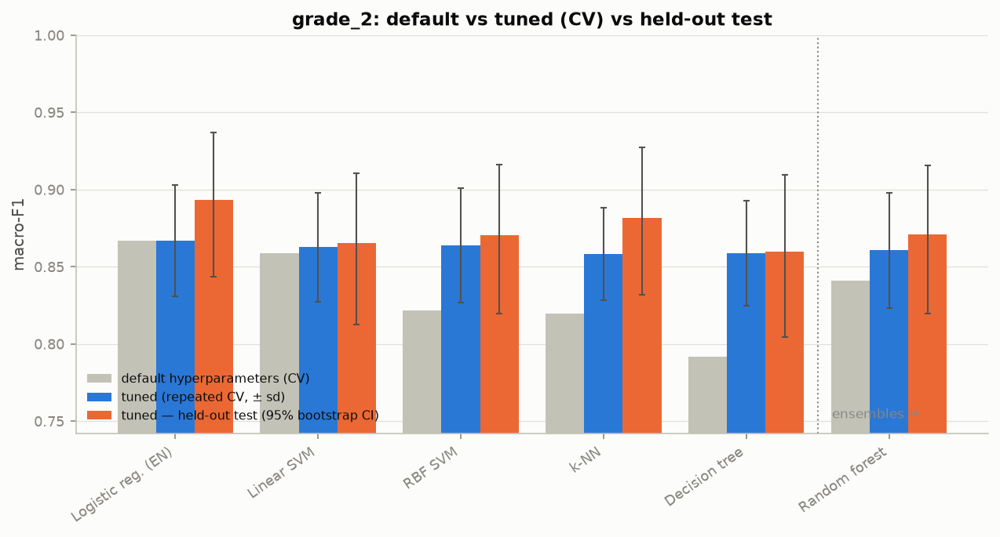

*grade_2: default vs tuned vs test*


| model              |   default_cv_f1 |   cv_f1 |   cv_f1_sd |   train_f1 |   overfit_gap |   tuning_gain |   test_f1 |   f1_macro_ci_lo |   f1_macro_ci_hi |
|:-------------------|----------------:|--------:|-----------:|-----------:|--------------:|--------------:|----------:|-----------------:|-----------------:|
| Logistic reg. (EN) |           0.867 |   0.867 |      0.036 |      0.867 |        -0.000 |         0.000 |     0.893 |            0.843 |            0.937 |
| Linear SVM         |           0.859 |   0.863 |      0.035 |      0.862 |        -0.000 |         0.004 |     0.865 |            0.813 |            0.911 |
| RBF SVM            |           0.822 |   0.864 |      0.037 |      0.863 |        -0.001 |         0.042 |     0.871 |            0.820 |            0.916 |
| k-NN               |           0.820 |   0.858 |      0.030 |      0.869 |         0.011 |         0.039 |     0.881 |            0.832 |            0.927 |
| Decision tree      |           0.792 |   0.859 |      0.034 |      0.859 |        -0.000 |         0.067 |     0.860 |            0.804 |            0.909 |
| Random forest      |           0.841 |   0.861 |      0.037 |      0.868 |         0.008 |         0.020 |     0.871 |            0.820 |            0.916 |


**All test metrics**

| model              |   accuracy |   balanced_accuracy |   f1_macro |   f1_weighted |   mcc |   kappa |   log_loss |   roc_auc |   pr_auc |
|:-------------------|-----------:|--------------------:|-----------:|--------------:|------:|--------:|-----------:|----------:|---------:|
| Logistic reg. (EN) |      0.894 |               0.905 |      0.893 |         0.895 | 0.799 |   0.788 |      0.350 |     0.913 |    0.855 |
| Linear SVM         |      0.866 |               0.877 |      0.865 |         0.867 | 0.745 |   0.733 |      0.352 |     0.909 |    0.849 |
| RBF SVM            |      0.872 |               0.882 |      0.871 |         0.872 | 0.754 |   0.743 |      0.348 |     0.911 |    0.835 |
| k-NN               |      0.883 |               0.890 |      0.881 |         0.883 | 0.770 |   0.764 |      0.597 |     0.924 |    0.824 |
| Decision tree      |      0.860 |               0.876 |      0.860 |         0.861 | 0.744 |   0.724 |      0.371 |     0.876 |    0.751 |
| Random forest      |      0.872 |               0.884 |      0.871 |         0.872 | 0.758 |   0.744 |      0.320 |     0.932 |    0.876 |

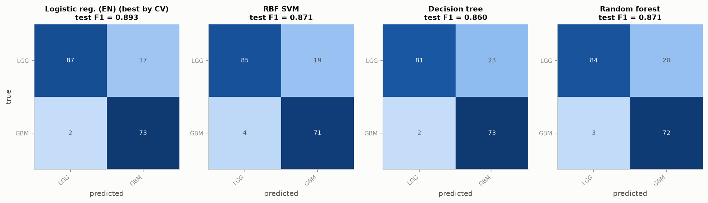

*grade_2: confusion matrices (test)*


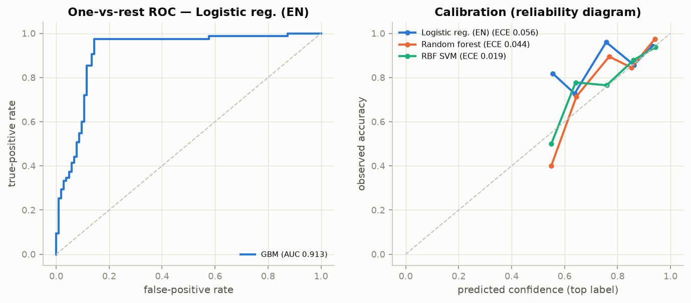

*grade_2: ROC curves and calibration*


**Per-class (best model)**

|              |   precision |   recall |   f1-score |   support |
|:-------------|------------:|---------:|-----------:|----------:|
| LGG          |       0.978 |    0.837 |      0.902 |   104.000 |
| GBM          |       0.811 |    0.973 |      0.885 |    75.000 |
| accuracy     |       0.894 |    0.894 |      0.894 |     0.894 |
| macro avg    |       0.894 |    0.905 |      0.893 |   179.000 |
| weighted avg |       0.908 |    0.894 |      0.895 |   179.000 |


**Statistical comparison against the best model**

| vs_model      |   cv_f1_diff |   corrected_t |   corrected_t_p |   mcnemar_b |   mcnemar_c |   mcnemar_p |
|:--------------|-------------:|--------------:|----------------:|------------:|------------:|------------:|
| Linear SVM    |        0.004 |         0.478 |           0.644 |           6 |           1 |       0.125 |
| RBF SVM       |        0.003 |         0.316 |           0.759 |           5 |           1 |       0.219 |
| k-NN          |        0.009 |         0.970 |           0.357 |           5 |           3 |       0.727 |
| Decision tree |        0.008 |         2.212 |           0.054 |           6 |           0 |       0.031 |
| Random forest |        0.006 |         1.050 |           0.321 |           4 |           0 |       0.125 |

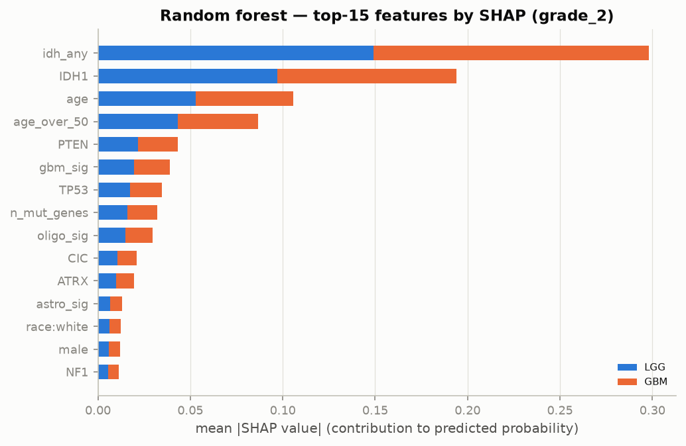

*grade_2: SHAP feature importance (random forest)*


**Elastic-net logistic regression**: 21 non-zero features; largest coefficients per class:

| class   | feature     |   coef |
|:--------|:------------|-------:|
| GBM     | idh_any     | -0.786 |
| GBM     | IDH1        | -0.634 |
| GBM     | age         |  0.444 |
| GBM     | TP53        |  0.299 |
| GBM     | age_over_50 |  0.250 |
| GBM     | NOTCH1      | -0.237 |


**Error analysis**: misclassified test patients (19)

| patient      | true   | pred   |   p_max | histology         | who_grade   |     age |   purity | batch_tss   | idh_status   | codel_1p19q   | subtype_7        |
|:-------------|:-------|:-------|--------:|:------------------|:------------|--------:|---------:|:------------|:-------------|:--------------|:-----------------|
| TCGA-06-5416 | GBM    | LGG    |   0.946 | glioblastoma      | G4          |  23.000 |    0.790 | 06          | nan          | non-codel     | nan              |
| TCGA-14-1456 | GBM    | LGG    |   0.889 | glioblastoma      | G4          |  23.000 |    0.800 | 14          | Mutant       | non-codel     | G-CIMP-high      |
| TCGA-DU-7013 | LGG    | GBM    |   0.880 | astrocytoma       | G3          |  59.000 |    0.960 | DU          | WT           | non-codel     | Classic-like     |
| TCGA-DU-8158 | LGG    | GBM    |   0.846 | astrocytoma       | G3          |  57.000 |    0.700 | DU          | WT           | non-codel     | Mesenchymal-like |
| TCGA-DU-8162 | LGG    | GBM    |   0.769 | oligoastrocytoma  | G3          |  61.000 |    0.200 | DU          | WT           | non-codel     | Mesenchymal-like |
| TCGA-DU-8165 | LGG    | GBM    |   0.862 | oligodendroglioma | G3          |  60.000 |    0.580 | DU          | WT           | non-codel     | Mesenchymal-like |
| TCGA-DU-A76K | LGG    | GBM    |   0.901 | oligodendroglioma | G2          |  87.000 |    0.610 | DU          | WT           | non-codel     | Classic-like     |
| TCGA-DU-A76L | LGG    | GBM    |   0.667 | oligodendroglioma | G3          |  54.000 |    0.640 | DU          | WT           | non-codel     | Mesenchymal-like |
| TCGA-DU-A7TB | LGG    | GBM    |   0.935 | oligodendroglioma | G2          |  56.000 |    0.680 | DU          | WT           | non-codel     | PA-like          |
| TCGA-DU-A7TI | LGG    | GBM    |   0.613 | nan               | nan         | nan     |    0.730 | DU          | nan          | non-codel     | nan              |
| TCGA-FG-6688 | LGG    | GBM    |   0.909 | astrocytoma       | G3          |  59.000 |    0.380 | FG          | WT           | non-codel     | Mesenchymal-like |
| TCGA-FG-6692 | LGG    | GBM    |   0.888 | oligodendroglioma | G3          |  63.000 |    0.840 | FG          | WT           | non-codel     | Classic-like     |
| TCGA-HT-8110 | LGG    | GBM    |   0.869 | astrocytoma       | G3          |  57.000 |    0.570 | HT          | WT           | non-codel     | Mesenchymal-like |
| TCGA-HT-8564 | LGG    | GBM    |   0.645 | astrocytoma       | G3          |  47.000 |    0.660 | HT          | WT           | non-codel     | PA-like          |
| TCGA-HT-A5RC | LGG    | GBM    |   0.813 | astrocytoma       | G3          |  70.000 |    0.720 | HT          | WT           | non-codel     | Classic-like     |

## 8. External validation (independent hospitals, different platform)

> **Preliminary:** these numbers were computed with an earlier (smoke-test) tuning of the models. Re-run `glioma-external` to refresh them with the final hyperparameters.


The Task-A models were retrained on rank-normalised shared genes and applied **without any refitting** to two
GEO microarray cohorts. Because both cohorts use a different platform (microarray) from different institutions,
this is a much harder test than the TCGA test split.

**GSE107850, EORTC 22033 trial (IDH status known).** P(IDH-mutant) = P(non-codel) + P(codel):

| model              |   shared_genes |   n |   tcga_test_f1_rank_normalised |   n_idh_known |   n_idh_wt |   idh_auc |   idh_accuracy |   idh_balanced_accuracy |   idh_sensitivity_mut |   idh_specificity_wt |
|:-------------------|---------------:|----:|-------------------------------:|--------------:|-----------:|----------:|---------------:|------------------------:|----------------------:|---------------------:|
| Logistic reg. (EN) |          18725 | 195 |                          0.969 |       180.000 |     14.000 |     0.863 |          0.967 |                   0.818 |                 0.994 |                0.643 |
| Random forest      |          18725 | 195 |                          0.978 |       180.000 |     14.000 |     0.865 |          0.967 |                   0.851 |                 0.988 |                0.714 |

**GSE16011, Gravendeel (histology only).** Concordance with histology. About 90% of adult GBMs are IDH-wildtype,
and most true oligodendrogliomas are 1p/19q-codeleted:

| model              |   shared_genes |   n |   tcga_test_f1_rank_normalised |   gbm_pred_idhwt |   oligo_pred_codel |
|:-------------------|---------------:|----:|-------------------------------:|-----------------:|-------------------:|
| Logistic reg. (EN) |          16605 | 276 |                          0.977 |            0.849 |              0.673 |
| Random forest      |          16605 | 276 |                          0.978 |            0.843 |              0.731 |

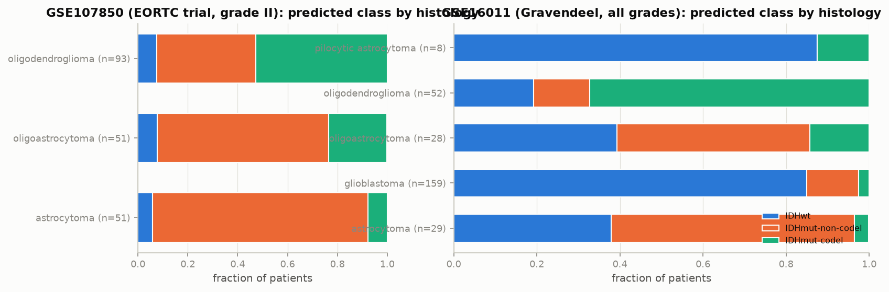

*Predicted molecular class by histology in the external cohorts (elastic-net LR)*


## 9. Comparison with published work (scraped literature)

`glioma-literature` queried PubMed and retrieved 243 papers. It extracted 164 numeric metric
statements from 74 abstracts (see `tables/literature_metrics.csv`). The directly
comparable baseline is Task C:

| study                                                                                                                | PMID     |   TCGA LGG-vs-GBM accuracy | source quote (abstract)                                                                                    |
|:---------------------------------------------------------------------------------------------------------------------|:---------|---------------------------:|:-----------------------------------------------------------------------------------------------------------|
| Tasci et al. 2022, Int J Mol Sci — hierarchical voting feature selection + soft-voting ensemble (source of UCI #759) | 36430631 |                      0.876 | “achieves 87.606% and 79.668% accuracy rates on TCGA”                                                      |
| Tasci et al. 2023 (GradWise), Cancers — mRMR + LASSO hybrid feature selection                                        | 37760597 |                      0.870 | “accuracy rate of 87.007% with 13 features and an accuracy rate of 80.412% with five features on the TCGA” |
| **This project**: Logistic reg. (EN) (selected by CV), held-out test                                                 | —        |                      0.894 | test n=179, macro-F1 95% CI 0.843–0.937                                                                    |

Note on comparability: Tasci et al. used the 839-patient UCI table. Here the table was rebuilt from GDC
(891 exome-sequenced patients), and a test split is held out rather than using CV only.

For Task A there is no identical published benchmark on this exact split. Ceccarelli 2016 defines the labels
from IDH sequencing and copy number. The point of Task A is that **expression alone** recovers that molecular
diagnosis, which is useful when only RNA is available.


## 10. Conclusions

* **Task A (WHO-2021 subtype from expression):** Logistic reg. (EN), test macro-F1
  0.970. The three molecular classes are almost perfectly recoverable from the
  transcriptome. The derived chromosome-arm scores alone (~40 features) reach ~0.95–0.96. This shows the model
  is reading the *biology* (1p/19q loss, +7/−10, IDH-associated programs), not noise.
* **Task B (7 methylation subtypes)** is a planned extension: its feature ablation is reported in §3, but it has not been tuned or evaluated in this version.
* **Task C (LGG vs GBM, Tasci setup):** Logistic reg. (EN), test macro-F1
  0.893, in line with the published ~87% accuracy. The ceiling comes from the
  labels themselves: TCGA "LGG" includes grade-III IDH-wildtype tumours that are biologically GBM under WHO 2021.
* **Regularisation** mattered most for single trees and k-NN (train F1 = 1.0 by default). For linear models,
  elastic-net gave sparse, interpretable gene sets at equal accuracy.
* **Ensembles** gave robust but not dramatic gains when the base learners are already near the ceiling. Their
  main benefit here is lower variance across folds: a single tree is clearly worse than the forest.

**Limitations:**
* The data are retrospective TCGA cohorts with batch-confounded sites.
* External cohorts lack 1p/19q status, so only IDH status and histology concordance can be checked externally.

## Reproduce

```bash
uv sync
uv run glioma-all             # every stage in order (download → … → report); see `glioma-all --list`
uv run glioma-all --from evaluate   # only the cheap reporting stages
uv run pytest
```

Training takes under 30 min for Task A and ≈ 2 min for Task C on an 8-core laptop (`--fast` for a smoke test).
